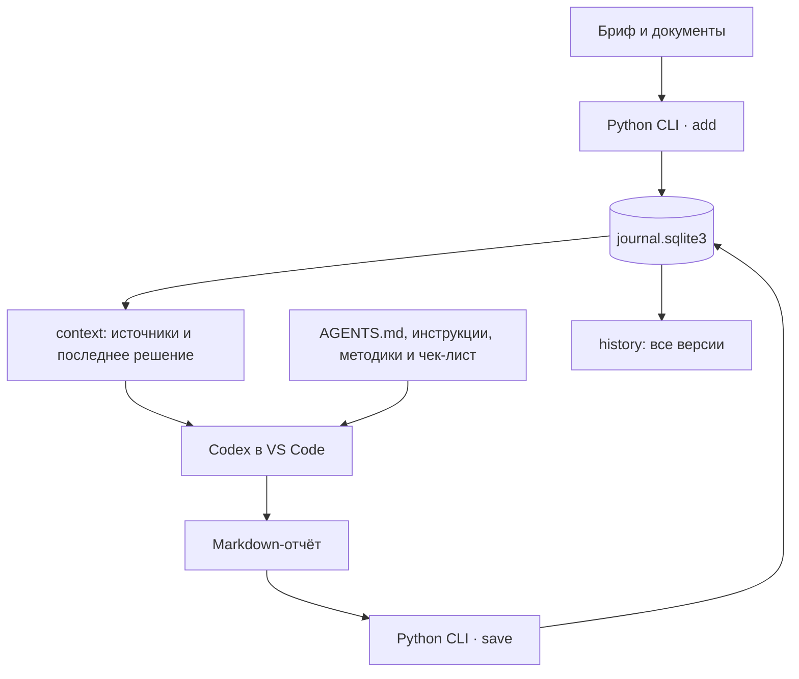

# Устройство ProductMind

Один продуктовый вопрос соответствует одной рабочей папке в projects/. Терминал и сессия Codex используют один локальный журнал. Исходный файл можно открыть для сверки, но для чтения уже извлечённого текста достаточно базы.

## Что запоминает проект

| Таблица | Содержимое | Для чего хранится |
| --- | --- | --- |
| sources | ID, путь, тип материала, SHA-256 исходных байтов, время импорта UTC, JSON извлечённых блоков | Открыть тот же фрагмент по ссылке S1 и координатам. Отличать новую редакцию от повторного импорта |
| decisions | ID версии, номер предыдущей версии, ID использованных источников, полный текст отчёта, причина записи и время UTC | Восстановить последний выбор, проверить его основания и прочитать прежние решения |

`S1` означает источник с ID 1 в данном журнале. Строка таблицы, страница PDF или абзац DOCX дают более точную ссылку. SHA-256 относится к исходному файлу целиком. В базе лежит извлечённый текст, поэтому изображения и исходное оформление по ней восстановить нельзя.

## Путь от брифа к решению

1. Агент выбирает папку проекта. Команда add с флагом --brief импортирует бриф. Остальные материалы принимает та же команда без флага. Совпадение пути, типа и хеша возвращает прежний ID. Изменение файла по тому же пути создаёт новую запись. Ошибка в пакете импортируемых файлов откатывает запись всего пакета.
2. context возвращает номер текущей версии, все источники и последний полный отчёт. При новом проекте версия равна нулю. Вложения остаются недоверенными данными. Codex сверяет цитаты, фиксирует неопределённость и сравнивает варианты по правилам проекта.
3. Агент сохраняет Markdown-отчёт, затем передаёт в save его путь, причину решения, прочитанную базовую версию и ID использованных источников. В транзакции CLI сверяет версию и наличие ID. Если параллельно появился новый отчёт, требуется перечитать context. Текст отчёта и его источники доступны после закрытия сессии.
4. При новом материале агент повторяет add и context, сравнивает прежние основания с новыми и пишет отдельный отчёт. Критерием пересмотра служит изменение основания. История может зафиксировать и сохранение прежнего выбора с объяснением. Каждая запись ссылается на предшествующую версию.

STATE.md, SOURCES.md и DECISIONS.md — краткие представления для человека. Их поддерживает агент. CLI не синхронизирует Markdown автоматически. Оригинальные версии отчётов и причины выбора доступны через history.

## Пример восстановления

Основной youth-retention хранит один бриф и одно решение. Для технического испытания закрытый журнал был скопирован в recovery-test. В копию добавлено синтетическое условие S2. Версия 2 предлагает сначала выяснить, возможно ли измерение по возрасту. В версии 1 предлагалось проверить само снижение. Ссылки на материалы и протокол независимого чтения приведены в [TESTING.md](../projects/youth-retention/TESTING.md).
